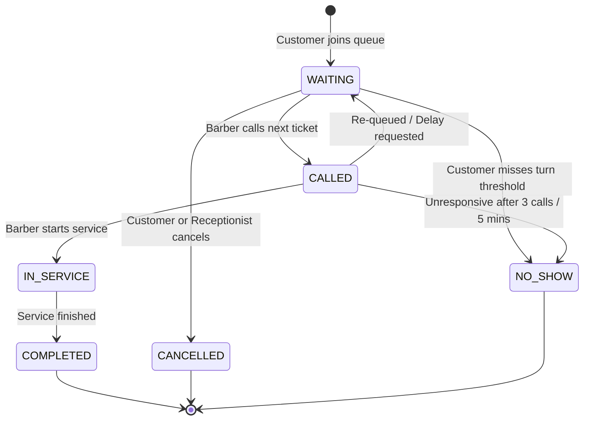

# 03-flows-rules.md — Queue Rules, State Machines & Protocols

## 1. Ticket Lifecycle State Machine

A ticket moves through deterministic state transitions:

### State Descriptions
- `WAITING`: Ticket has entered the queue; wait time and position dynamically tracked.
- `CALLED`: Barber station is ready; notification triggered on customer screen and TV display chime sounded.
- `IN_SERVICE`: Customer is in the styling chair; active timer begins.
- `COMPLETED`: Finished and archived into daily analytics.
- `CANCELLED`: Voluntarily dropped by customer or removed by receptionist.
- `NO_SHOW`: Marked if customer is absent when called.

---

## 2. Dynamic Wait Time Calculation Rules

Wait time for a ticket $i$ is calculated based on:
1. **Assigned Barber**:
   - If a specific barber is requested, wait time equals the sum of remaining durations of active and queued tickets in that barber's queue.
   - If "Any Barber" is selected, wait time is determined using a work-stealing pool model across all currently active barbers:
     $$\text{Estimated Wait} = \frac{\sum \text{Pending Service Durations}}{\text{Number of Active Barbers}}$$
2. **Buffer Allowance**: An adaptive buffer of $+3\text{ minutes}$ is added between client turnovers.
3. **Elapsed Service Offset**: Active tickets subtract elapsed service minutes from remaining calculation.

---

## 3. Real-Time Socket.IO Event Contracts

| Event Name | Direction | Payload Schema | Description |
|------------|-----------|----------------|-------------|
| `connection` | Client ➔ Server | Handshake query `{ clientId }` | Establishes client session |
| `subscribe:ticket` | Client ➔ Server | `{ ticketId }` | Joins room `ticket:<id>` |
| `subscribe:barber` | Client ➔ Server | `{ barberId }` | Joins room `barber:<id>` |
| `queue:updated` | Server ➔ Clients | `{ queue, stats, timestamp }` | Broadcast to lobby and reception |
| `ticket:called` | Server ➔ Clients | `{ ticketId, ticketNumber, barberName, station }` | Audio/Visual trigger for TV and user screen |
| `ticket:status_change`| Server ➔ Clients | `{ ticketId, status, timestamp }` | Targeted room notification |
| `barber:status_change`| Server ➔ Clients | `{ barberId, status, activeTicket }` | Broadcast station availability |

---

## 4. Bilingual Localization (i18n) Rules
- Supported Languages: English (`en`) and Gujarati (`gu`).
- Persisted in browser `localStorage` under key `salon_language`.
- Both technical and conversational phrases must render cleanly with proper grammar and contextual terminology.
- Numbers, timestamps, and currency (₹ INR) format dynamically according to active locale.

---

## 5. Security & Authentication Model
- **Customer Pages (`/`, `/join`, `/status/:id`)**: Zero-auth public access.
- **TV Display (`/display`)**: Read-only public presentation mode.
- **Reception & Barber Consoles (`/reception`, `/barber/:name`)**: PIN-based quick authentication (`STAFF_PIN` or individual barber PIN).
- **Admin (`/admin`)**: Protected via administrative passcode.
